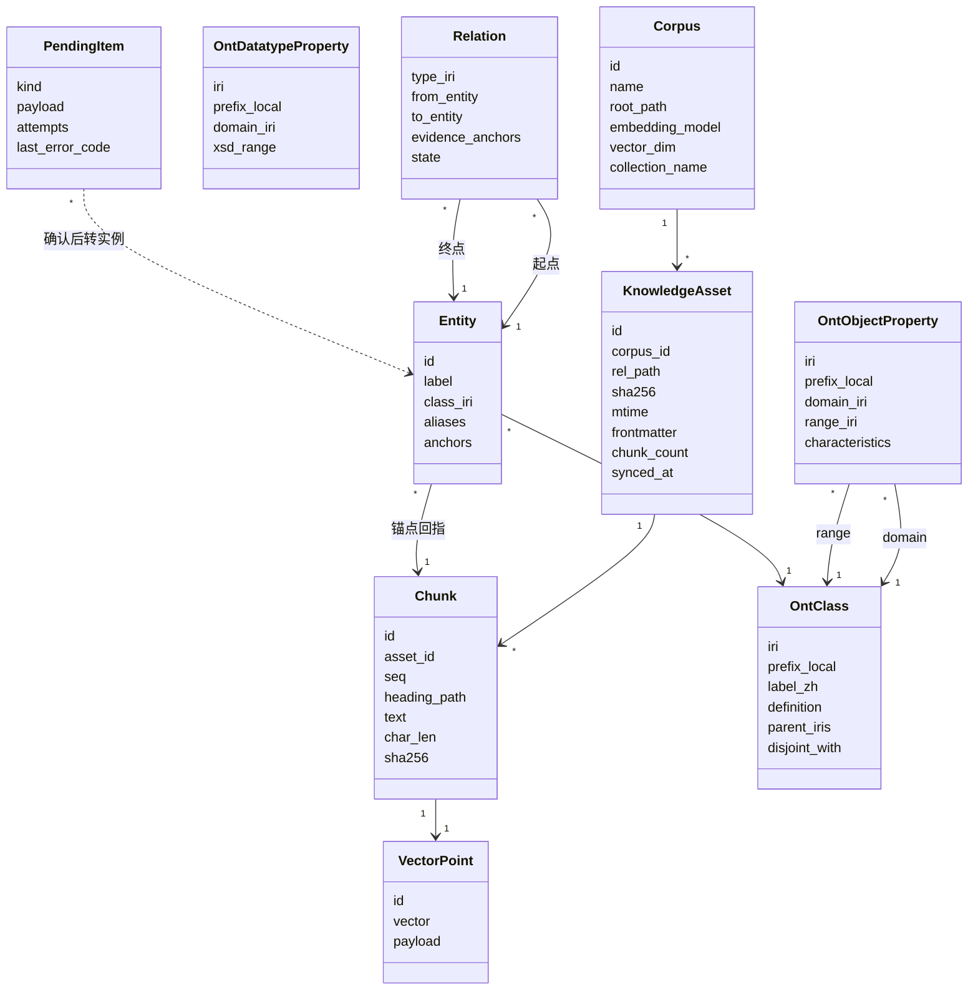
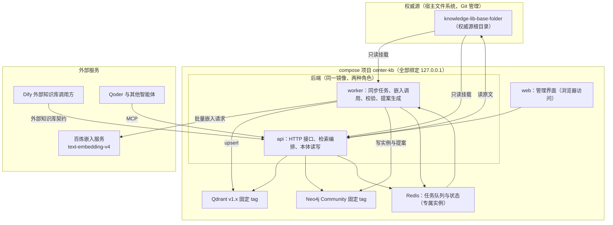
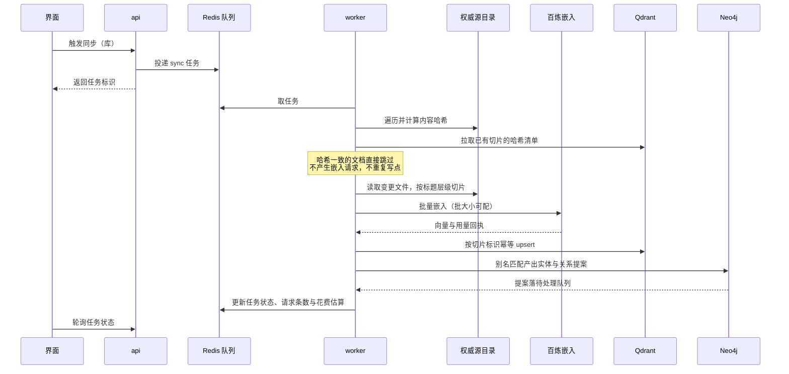
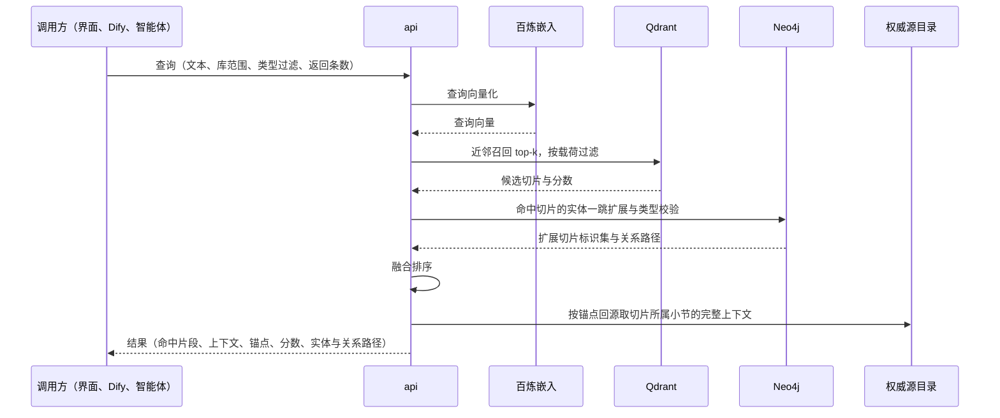
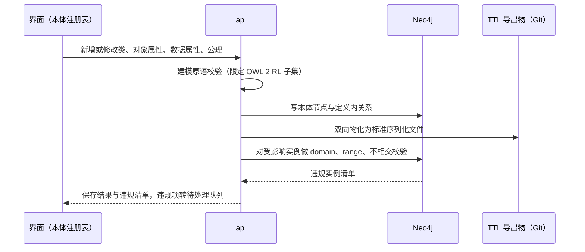

# 中心知识库概念需求

版本：v1.1　　状态：概念需求　　适用部署：单机 Docker Desktop

---

## 1. 定位

本系统是个人知识资产的检索底座与语义索引层。它把长期沉淀的 Markdown 笔记变成一个可被语义检索、可被程序与智能体调用的知识源，并在其上维护一套符合 RDF/OWL 建模规范的本体，用于概念归类、实体归一和关系扩展召回。

系统由三部分构成，职责边界固定：

| 层 | 载体 | 定位 | 可否删除重建 |
| --- | --- | --- | --- |
| 知识资产 | Markdown 文件目录，根目录固定命名为 knowledge-lib-base-folder | 正文的唯一权威源 | 权威源，不可由系统重建 |
| 检索索引 | Qdrant | 派生索引，存切片正文与嵌入向量 | 可整库重建，重建需重新调用嵌入服务 |
| 语义索引 | Neo4j | 派生索引，存本体定义与实例关系 | 可整库重建，重建不额外调用模型 |

检索是主干，语义索引是增强层：查询主路径为向量近邻召回，图谱只承担一跳或两跳的关系扩展、类型过滤与实体归一后的结果合并，不作为独立入口。

## 2. 范围与非目标

范围内：Markdown 与纯文本的入库同步、按标题层级的切片、云端嵌入向量写入、混合检索、本体建模与校验、实体与关系的建立和确认、手动触发的 LLM 辅助知识建模（先本体归纳、后实体与关系抽取，两阶段）、图谱只读浏览、索引重建、对外接口。

非目标，明确不实现：

1. 多用户、角色与权限体系。系统为单人本机工具，仅做本机访问边界。
2. 正文的在线编辑。修改一律发生在权威源文件上，界面只提供只读预览与跳转。
3. OWL 推理机。本体校验按规则实现，不部署 HermiT、ELK 一类描述逻辑推理服务。若后续需要隐含公理推导，走第 8 节校验器扩展点并重新决策。
4. 独立 RDF 三元组存储。本体定义与实例同库承载，标准合规通过导出物与建模原语约束保证，不引入 Fuseki 或 Oxigraph。
5. PDF、Word、网页剪藏等非文本解析。首期只实现 Markdown 解析器，解析接口预留但不实现其他类型。
6. 替代 Dify 的应用编排、提示词管理与 Agent 工作流。
7. 复用本机既有栈的任何数据组件。Qdrant、Neo4j、Redis 一律新建专属实例，不接入 hermes 系列服务，不并入既有业务向量实例（运行时记忆与个人知识资产生命周期不同）。

## 3. 术语与核心概念

以下六项是贯穿全文的核心概念，组件划分、数据实体、流程与扩展点均围绕它们定义。

**知识资产（Knowledge Asset）**　存于权威源根目录 knowledge-lib-base-folder 中的一份原始文件及其全部正文内容。该目录内的一切编辑都视为对权威源的直接修改，系统对其只读。任何组件不复制正文作为长期存储。

**库（Corpus）**　一组按主题或来源聚合的知识资产的逻辑边界，对应权威源根目录下的一个子目录。一个库对应一个 Qdrant collection 和一组本体命名空间约定，是同步、重建、统计和权限划分的最小单位。

**切片（Chunk）**　入库与检索的最小正文单位，由库所属解析器按标题层级与长度规则产出。切片携带标题路径，其标识由文档相对路径与内容哈希共同派生，因此同一内容重复入库不会产生新切片。

**锚点（Anchor）**　派生索引回指权威源的定位结构，固定为三元组：文档相对路径、切片序号、内容哈希。向量记录的载荷与图谱实体节点都只持锚点，检索命中后按锚点回到文件读取原文。锚点是本系统解决双写一致性的唯一手段。

**本体要素（Ontology Element）**　建模原语，限定在 OWL 2 RL 子集内，共四类：类（Class）、对象属性（ObjectProperty）、数据属性（DatatypeProperty）、公理与约束（Axiom）。每个本体要素必须有国际统一资源标识符（IRI）、前缀本地名、中文标签与定义注释。

**实体提案（Entity Proposal）**　由匹配或抽取产生的、尚未人工确认的实体与关系候选。所有提案落待处理队列，确认后成为实例，未确认的提案不参与检索扩展。

**本体提案（Ontology Proposal）**　由 LLM 归纳产生的、尚未人工确认的候选本体要素（类、对象属性与数据属性）。确认后写入本体注册表并物化 TTL，未确认的不参与实体抽取的签名。

**待处理队列（Pending Queue）**　承载五类待人工裁决条目：本体提案、实体提案、关系提案、本体校验失败项、嵌入与抽取调用失败项。它是系统在不做静默拒收的前提下的兜底出口。

## 4. 概念模型

关键约束：

- `Chunk` 正文只存于 Qdrant 载荷与权威源文件两处，其中权威源为准；Neo4j 实体节点不持有正文字段。
- `Entity.anchors` 是数组而非单值，一个实体可由多个文件的多个切片支撑。
- `Relation` 与 `Entity` 均携带声明的本体 IRI，写入时按 `OntClass` 与 `OntObjectProperty` 的 domain 与 range 校验。
- Qdrant collection 按库建立，命名为 `kb_<corpus_id>`；模型名与维度写入 collection 元数据，作为不可变标识。

## 5. 组件划分

组件职责与依赖：

| 组件 | 单一职责 | 使用方式 | 依赖 |
| --- | --- | --- | --- |
| api | 接收界面与外部调用，编排检索与融合排序，按锚点回源取原文，读写本体 | HTTP，本机 127.0.0.1:8101 | Qdrant、Neo4j、权威源目录、Redis |
| worker | 执行同步任务：扫描、切片、嵌入调用、载荷写入、提案生成、校验入队 | 由 api 投递任务，长任务不占用请求线程 | Redis、Qdrant、Neo4j、权威源目录、百炼 |
| web | 库与文档管理、同步触发与状态、检索测试、本体注册表编辑、实体归一、图谱只读 | 浏览器访问 127.0.0.1:8100 | api |
| Qdrant | 切片正文与向量的存储与近邻检索 | 宿主端口 6340/6341 | 命名卷 |
| Neo4j | 本体定义、实体、关系与待处理条目的存储与图查询 | 宿主端口 7474/7687 | 命名卷 |
| Redis | 任务队列、任务状态与检索缓存 | 宿主端口 6380 | 命名卷 |

api 与 worker 使用同一镜像、以不同启动命令拆成两个 service，目的是让批量嵌入与全量重建不阻塞界面请求。Qdrant、Neo4j、Redis 均为本系统专属实例，使用本编排的独立命名卷，与本机任何既有栈互不共用；端口错开方案见 7.2 节 NFR-07。

## 6. 主流程

### 6.1 入库同步

要点：

- 增量判定以内容哈希为唯一依据，文件修改时间只用于缩小遍历范围，不作为是否重嵌入的条件。文档级内容哈希随该文档的全部切片载荷冗余存储，同步时按相对路径拉取比对，以此跳过未变更文档，不额外引入第四份存储。
- 一次同步内，文档级并行、切片级批量。嵌入请求失败按错误码分类处理，见 7.2 节 NFR-09。
- 提案生成首期只依赖本体注册表中的类名与别名做匹配。LLM 辅助知识建模为独立的手动触发能力（见 FR-14），分两阶段：先对采样切片做本体归纳（产出本体提案，确认后进入本体注册表），再按已确认本体对选定切片抽取实体与关系提案；两阶段都不在同步管道内自动执行，结果与别名词典匹配同样落待处理队列；扩展点见第 8 节。
- 删除权威源文件后触发同步，对应切片与向量随之从索引移除，实体不自动删除，转入待处理队列由人工裁决。

### 6.2 检索

要点：

- Qdrant 载荷中的切片正文用于召回判定与命中片段展示，权威源文件用于取更大的上下文段落并对正文做逐字校验。二者分工固定，界面与接口返回的正文一律以回源结果为准。
- 融合排序默认采用倒数排名融合（RRF），把向量召回序与图扩展命中序合并，权重与是否启用图扩展均为库级可配项，默认启用。
- 图谱扩展只在已确认实例上进行，待处理提案不参与召回。
- 回源读取原文发生在排序之后，只为将要返回的结果读文件。文件以只读方式访问，读不到即该条结果标记失效并记入任务日志。
- 返回结构必须携带锚点三元组，使调用方可自行校验正文是否已变更。

### 6.3 本体编辑与标准物化

要点：

- 界面编辑动作与 OWL 序列化保持单一映射：一次保存同时更新库内定义与文件导出物，二者由同一次事务产生，不允许手工只改一侧。
- 建模原语限定在 OWL 2 RL 可判定子集：子类、等价类、对象属性与数据属性、domain 与 range、属性特征（传递、对称、函数性、反函数性）、不相交、基数约束。超出子集的构造在界面直接拒绝并说明原因。
- 校验按规则实现，覆盖上述构造的可判定部分，不做隐含公理推导，也不做全量实例的分类。
- 本体命名空间前缀在库创建时确定，后续新增项继承，防止本地名冲突。
- 每次本体保存生成一个序列化版本标识，实例节点记录其声明时所依据的版本标识，便于本体变更后识别过期实例。

### 6.4 索引重建

重建分两种，代价不同，界面上分列入口并明示后果：

- 结构重建：仅按当前切片规则重新切片与写载荷，不重新计算向量。仅在与当前嵌入无关的操作时使用，切片规则变更后不适用。
- 全量重嵌入：删除 collection 后按权威源重新切片并调用嵌入服务。会产生与文档量成正比的费用与耗时，界面需在执行前给出预估请求条数并要求二次确认。

嵌入模型或向量维度变更一律走新建 collection 路径，新旧 collection 并存至验证通过后切换，不在原 collection 上覆盖写。

## 7. 需求条目清单

以下条目按编号引用，实现与验收阶段逐条核对。FR 为功能需求，NFR 为非功能需求。

### 7.1 功能需求

| 编号 | 需求条目 | 验收判据 |
| --- | --- | --- |
| FR-01 | 库管理：创建、改名、归档、删除；创建时确定权威源子目录、嵌入模型、维度、切片规则与本体前缀 | 新建库后 collection 与本体命名空间同步生成，嵌入模型与维度不可后期修改 |
| FR-02 | 同步触发：手动按库触发、按单文件触发、定时轮询触发，默认每 30 分钟轮询一次，按库可配 | 三种触发方式共用同一套增量判定逻辑，结果一致；轮询只对有变更的文档产生嵌入请求 |
| FR-03 | 切片查看：按文档展开切片树，显示标题路径、长度、内容哈希、嵌入状态 | 任一切片可查看正文并核对与权威源一致 |
| FR-04 | 检索测试：输入查询，返回结果列表、分数来源、融合前后排名、实体与关系路径 | 同一条结果可直接跳转到权威源文件与切片序号 |
| FR-05 | 元数据过滤检索：按库、按标签、按时间范围、按本体类型过滤 | 过滤条件在向量检索阶段以载荷条件下推，不在取回后内存过滤 |
| FR-06 | 本体注册表：类与属性的增删改查、层级浏览、定义注释维护 | 保存后标准序列化文件同步更新，可被 Protégé 打开 |
| FR-07 | 实例校验：本体变更后列出违规实例并支持就地改类型或转待处理 | 违规实例不会静默保留 |
| FR-08 | 实体与关系建立：手工新建、别名维护、从提案确认 | 确认后的关系可参与检索扩展，未确认的不参与 |
| FR-09 | 实体归一：同名与别名冲突检测、合并、拆分 | 合并后被合并实体的锚点并入留存实体，无锚点丢失 |
| FR-10 | 图谱只读浏览：按实体为中心展开一至二跳，支持按类型着色 | 界面不提供画布直接建关系；关系建立走 FR-08 |
| FR-11 | 任务与花费面板：同步进度、失败重试计数、嵌入请求条数与费用估算、待处理队列积压数 | 面板数据与后端任务记录一致 |
| FR-12 | 对外接口：HTTP 检索与图谱查询接口、Dify 外部知识库契约端点、MCP 工具描述 | 三类调用方复用同一套检索编排，同一条查询在三处返回的正文、分数与锚点一致 |
| FR-13 | 备份与恢复辅助：卷快照脚本、索引重建入口、从权威源目录恢复的完整流程 | 按第 9 节 V4 判据执行通过 |
| FR-14 | LLM 辅助知识建模（两阶段，手动）：阶段一本体归纳——本体界面按库或文档范围发起，对采样切片调用文本模型归纳候选类、对象属性与数据属性，产出本体提案经人工确认写入本体注册表；阶段二实体与关系抽取——按已确认本体签名对选定切片抽取实体与关系提案，落待处理队列由人工裁决 | 触发前展示预估调用数；归纳默认最多采样 20 个切片；抽取结果不直接生效；幻觉输出（名称不在正文、IRI 不在本体签名）被丢弃并计数；失败切片转待处理队列；验收见 V11 |

### 7.2 非功能需求

| 编号 | 需求条目 | 要求 |
| --- | --- | --- |
| NFR-01 | 一致性与幂等 | 切片标识由文档相对路径与切片内容哈希派生，写入为 upsert 语义，重复同步不产生重复点；派生索引允许短暂滞后于权威源，滞后状态在任务面板可见 |
| NFR-02 | 成本可控 | 嵌入与 LLM 抽取调用是仅有的按量支出项。增量判定以哈希为门槛跳过未变更内容；每次同步记录实际请求条数；全量重嵌入前必须给出预估并二次确认 |
| NFR-03 | 密钥边界 | 百炼密钥只经容器环境变量注入，来源为不进入版本库的本地环境文件；不出现在界面配置项、日志、任务记录与错误回显中 |
| NFR-04 | 网络与代理策略 | 本机持久代理会话结束后代理失效，常驻服务在无代理时会直接请求失败。api 与 worker 容器显式声明代理变量：对百炼走大陆直连，不继承宿主代理环境；仅在需要时按域名例外。实现后以关闭代理的状态实测一次 |
| NFR-05 | 文件监听方式 | Docker Desktop 在 Windows 上的挂载目录事件通知不可靠，不采用 inotify 事件驱动，改为手动触发与定时轮询内容哈希的组合，轮询间隔见 FR-02 |
| NFR-06 | 访问边界 | 所有宿主端口绑定 127.0.0.1，局域网不可达；Dify 容器走 Docker 网络内服务名，不经过宿主端口；接口以单一本机令牌校验，令牌经环境变量注入，Dify 外部知识库契约以请求头携带，界面与 MCP 走同一校验分支 |
| NFR-07 | 端口规划 | 本机已有 hermes-qdrant 占用 6333/6334、hermes-redis 占用 6379、Dify 占用 80/443/5003。本系统采用：web 8100、api 8101、Qdrant 6340 与 6341、Neo4j 7474 与 7687、Redis 6380，全部绑定 127.0.0.1；compose 项目名固定 center-kb，不使用默认项目名 |
| NFR-08 | 存储方式 | 权威源根目录 knowledge-lib-base-folder 以只读方式绑定挂载，宿主路径以环境变量配置，默认在项目目录下；索引数据使用命名卷，便于整卷删除与快照 |
| NFR-09 | 可观测性 | 任务状态、失败原因、错误码、重试次数、待处理队列积压写入持久记录，界面按库聚合展示 |
| NFR-10 | 性能目标 | 千级文档规模：单文件同步（不含嵌入等待）小于 2 秒；检索端到端含一次查询向量化与一跳图扩展，P95 小于 1.5 秒；全量重嵌入 30 分钟内完成 |
| NFR-11 | 镜像来源 | 镜像统一走已配置的加速前缀拉取，锁定次版本标签，不使用 latest |
| NFR-12 | 建模成本可控 | LLM 知识建模为手动触发能力，仅对显式选定的范围产生调用；本体归纳默认采样上限 20 片；触发前展示预估调用数并确认；每次任务记录实际调用数、令牌数与费用估算，单价来自实测记录并在统计面板展示 |

## 8. 扩展点

扩展点的接口形态在本节定义，首期只实现默认项，非默认项保持接口存在而无实现。

| 扩展点 | 接口契约 | 默认实现 | 预留实现 |
| --- | --- | --- | --- |
| 解析器 | 输入原始字节、文件元数据与前缀规则，输出文档头信息与切片序列 | Markdown，按标题层级与长度上限切片 | PDF、DOCX、网页剪藏、对话记录 |
| 嵌入后端 | 输入文本批次与模型参数，输出向量批次、维度与用量回执；失败按错误码分类 | 百炼 `text-embedding-v4` | 本机容器化嵌入模型，维度与模型名随 collection 变更而隔离 |
| 提案生成器 | 输入切片文本与本体签名（类、别名、属性），输出本体提案、实体提案与关系提案，全部落待处理队列 | 别名词典匹配；手动触发的 LLM 辅助知识建模（本体归纳 + 实体关系抽取，FR-14） | 抽取器的提示词与本体签名版本化，归纳与抽取结果与别名词典匹配复用同一队列与裁决闭环 |
| 融合排序 | 输入多路结果序列与各路权重，输出统一排序序列 | 倒数排名融合 | 评审模型重排序、按关系路径加权 |
| 校验器 | 输入本体定义与实例变更集，输出违规清单 | OWL 2 RL 子集规则校验 | 以本体的标准序列化物为输入接描述逻辑推理机，做隐含公理推导与一致性检查，推导结果回写实例 |
| 调用适配 | 输入统一检索请求结构，输出各调用方约定格式 | 本机 HTTP 接口 | Dify 外部知识库契约、MCP 工具、批量导出为其他智能体的上下文包 |

切片规则默认取值：单片长度上限 700 个中文字符，相邻片重叠 60 个字符，标题层级优先于长度约束，超出上限的单一小节按段继续切分。取值以库为粒度可配，配置变更只影响之后的同步，不追溯已入库内容，全量重建时按新规则重算。上限的最终取值受嵌入服务单条输入长度限制约束，见第 10 节第 1 项。

## 9. 验收标准

以下判据在实现完成后逐条执行，全部通过视为概念需求落地。

**V1 入库主干**　在 knowledge-lib-base-folder 下放入 200 篇 Markdown 笔记，新建库并触发同步，同步完成后：切片总数与文档数符合规则预期；Qdrant 中点数与切片数一致；检索一条只出现在某篇笔记中的表述，第一条结果即命中该切片，且按锚点回读的原文与文件内容逐字一致。

**V2 幂等**　对其中 5 篇不做任何修改后再次触发同步，嵌入请求条数为 0，Qdrant 点数不变；修改 1 篇正文后再次同步，仅该篇对应切片被重写，点数不增长，检索新表述可命中。

**V3 双索引一致**　任取一条检索结果，其向量载荷中的锚点、Neo4j 实体节点的锚点、权威源文件路径三者互相可解析且指向同一切片。Neo4j 侧不存任何正文字段，Qdrant 侧的正文仅到切片粒度，不含超出切片的冗余内容。

**V4 整库重建**　停止服务并删除 Qdrant 与 Neo4j 命名卷，仅凭权威源目录与本体序列化文件执行重建，重建后 V1 与 V3 判据复现。此项不承诺零成本，重嵌入调用量与文档数成正比，验收时记录实际请求条数。

**V5 本体标准合规**　从界面导出本体的标准序列化文件，用 Protégé 打开无解析错误；文件中每个类与属性均带前缀与完整 IRI，对象属性均声明 domain 与 range；尝试在界面创建 OWL 2 RL 子集之外的构造时被拒绝并给出原因说明。

**V6 实例校验**　将某对象属性的 range 从类 A 改为类 B 后保存，界面列出所有以该属性连接到类 A 实体的关系并转待处理队列，无一条被静默丢弃；逐条裁决后队列可清零。

**V7 图谱辅助检索**　构造两条切片：一条命中查询词但无实体关联，另一条向量分数较低但通过已确认关系与第一条相连。开启图扩展时第二条进入结果集，关闭时不进入，两次分数与排名差异在结果中可见。

**V8 提案闭环**　在注册表中为某类配置别名，触发同步后，包含该别名的切片产生实体提案；未确认前该实体不参与检索扩展，确认后参与；同一实体被三个不同文件的切片支撑时，锚点数组含三条记录。

**V9 访问与密钥边界**　在局域网另一台机器上无法访问任一宿主端口；界面任何页面、任何导出文件与全量日志中检索不到密钥字符串；关闭本机代理持久会话后，一次同步仍能成功。

**V10 对外接口**　以 Dify 外部知识库调用格式与 MCP 工具各发起一次检索，两者返回的正文、分数与锚点字段与界面检索结果一致，且服务端代码中检索编排逻辑只有一份。

**V11 LLM 知识建模闭环**　取未建模领域的语料，从本体界面手动发起本体归纳（范围限定到该文档），待处理队列出现类、对象属性与数据属性的本体提案（含中文标签、定义、IRI 预览）；确认后写入本体注册表并可从界面导出含新要素的 TTL。再发起实体与关系抽取，待处理队列出现绑定到新确认类与属性的实体提案与关系提案；确认后实体与关系建立并通过 domain 与 range 校验，参与检索扩展。对一条名称不在正文中的幻觉输出验证其被丢弃；记录两次任务的调用数、令牌数与费用估算。

## 10. 待确认项

1. 百炼 `text-embedding-v4` 的单批条数上限、单条输入长度上限、可选维度取值与计费单价，需以官方文档与一次实测调用确认，直接影响第 8 节切片长度与批大小的默认值。
2. Dify 外部知识库接口在本机 1.17.1 版本上的确切契约，需实测确认后固化到第 5 节 api 的适配层。
3. knowledge-lib-base-folder 的宿主位置：本文默认放在项目目录下并随项目仓库管理；是否独立成库、是否并入已有笔记目录，待定。
4. 模型辅助知识建模进入实现阶段的时机：V8 判据已跑通，已决策按路径 A 实施（手动触发的 LLM 辅助知识建模：本体归纳 + 实体关系抽取两阶段，见 FR-14）。
5. LLM 知识建模模型的选型与单价：默认按 qwen3.8-max 配置（实测可用），本体归纳与实体抽取共用同一模型；归纳输出 schema 的稳定性需以实测确认并留档。
